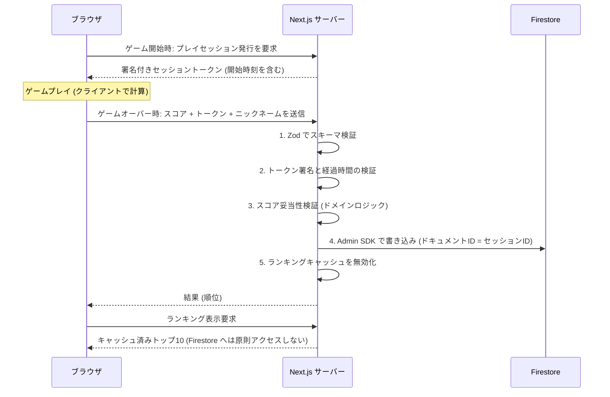

# ランキング機能 設計書 (Ranking System)

本ドキュメントは「Bug Invaders」を起点とするグローバルランキング機能の要件、設計、セキュリティ、料金見積もりを定義する。
上位方針は [Firebase 導入とセキュリティ戦略](./firebase-strategy.md) に従う。

- ステータス: 承認済 (Approved)
- 対象ゲーム: Bug Invaders (`bug_invaders`)。他ゲームへ横展開できる構造とする。

---

## 1. 目的 (Why)

| 目的 | 説明 |
| :--- | :--- |
| リプレイ動機の創出 | 「あと少しで10位に入れる」という目標を与え、再プレイ率を上げる。 |
| 他者の存在の可視化 | プレゼンス（プレイ中人数）に続き、「他のプレイヤーの記録」を見せることでプラットフォームとしての賑わいを演出する。 |
| 共通基盤の確立 | 今後追加するゲーム（タイピングRPG等）でも同じ仕組みでランキングを持てるようにする。 |

## 2. スコープ

### 2.1 MVP に含めるもの
1. ゲームオーバー画面でニックネームを入力し、スコアを送信できる。
2. ゲームオーバー画面およびランキングページ (`/ranking`) で、歴代トップ10を表示する。
3. 送信結果として「何位に入ったか（トップ10圏内の場合）」を表示する。
4. 前回入力したニックネームを `localStorage` に保存し、次回は入力済みにする。

### 2.2 MVP に含めないもの（将来検討）
- デイリー / ウィークリーランキング
- 個人のプレイ履歴、自己ベスト表示
- ログイン（認証）による本人性の保証
- 管理者によるスコア削除画面（MVP では Firebase コンソールから手動削除で運用）

## 3. 前提と制約

1. **ログインなし**: 誰が送信したかを保証できない。同一人物の複数登録や、なりすましニックネームは許容する。
2. **ゲームロジックはクライアントで動く**: スコアはブラウザ上で計算されるため、**改ざんを完全に防ぐことは原理的に不可能**である。本設計の目標は「完全防止」ではなく、以下に置く。
   - 素人の改ざん（DevTools でスコアを書き換えて送信する等）を確実に弾く。
   - 明らかに不可能な記録（理論値超え、人間の限界超え）を弾く。
   - Bot による連打で無料枠を枯渇させられないようにする。
3. **Spark プラン（無料枠）内で運用する**: Firestore は 1日あたり 読み取り 50,000 / 書き込み 20,000 / 削除 20,000 が上限。

---

## 4. 全体アーキテクチャ



### 4.1 原則
- **ブラウザは Firestore に一切直接アクセスしない**。Firestore の Security Rules は全拒否 (`allow read, write: if false`) とする。
- 読み書きはすべて Next.js サーバー上の `firebase-admin` 経由で行う（Admin SDK は Security Rules をバイパスする特権クライアント）。

---

## 5. データモデル (Firestore)

ゲームごとにコレクションを分け、境界づけられたコンテキストを保つ。

```text
games/{gameId}/scores/{sessionId}
```

| フィールド | 型 | 説明 |
| :--- | :--- | :--- |
| `nickname` | string | 1〜12文字。サーバーで正規化済み。 |
| `score` | number | 整数。0以上。 |
| `kills` | number | 撃破数。 |
| `maxCombo` | number | 最大コンボ数。 |
| `correctTyped` | number | 正しい打鍵数。 |
| `totalTyped` | number | 総打鍵数。 |
| `stage` | number | 到達ステージ。 |
| `durationMs` | number | サーバーが計測したプレイ時間（トークン発行から送信まで）。 |
| `createdAt` | Timestamp | サーバー時刻。 |
| `schemaVersion` | number | 将来のスキーマ変更に備えたバージョン。初期値 1。 |

- ドキュメントID をセッションID にすることで、**同じトークンでの二重送信（リプレイ攻撃）を追加コストなしで防ぐ**（Admin SDK の `create()` は既存IDだと失敗する）。
- `score` 降順のクエリはサブコレクション内の単一フィールドで完結するため、**複合インデックスは不要**。

---

## 6. セキュリティ設計（悪意あるユーザー対策）

想定する攻撃と対策の対応表。

| # | 攻撃 | 対策 | 層 |
| :--- | :--- | :--- | :--- |
| 1 | Firestore へ直接書き込み / 全件読み取り | Security Rules 全拒否。Admin SDK 経由のみ。 | インフラ |
| 2 | DevTools でスコアを書き換えて送信 | スコア妥当性検証（6.2）で理論値超えを拒否。 | ドメイン |
| 3 | 1秒で終わる偽のゲームを大量送信 | 署名付きセッショントークンでサーバー側の経過時間を計測し、打鍵速度の上限と照合。 | API |
| 4 | 同じ成功リクエストの再送（リプレイ） | ドキュメントID = セッションID による一意制約。 | データ |
| 5 | 巨大ペイロード / 型違反 / 不正文字 | Zod による厳格なスキーマ検証。未知のフィールドは拒否。 | API境界 |
| 6 | 不適切なニックネーム、HTML/スクリプト埋め込み | 文字種・長さ制限、簡易NGワード、React による自動エスケープ。 | ドメイン / UI |
| 7 | Bot による大量送信で無料枠枯渇 | セッション最短時間 + IP単位の簡易レートリミット + 予算アラート。 | API / 運用 |
| 8 | 外部スクリプトから API を直接叩く | Firebase App Check（フェーズ2で導入）。 | API |

### 6.1 署名付きセッショントークン
- ゲーム開始時にサーバーが `{ sessionId, gameId, issuedAt }` を HMAC-SHA256 で署名したトークンを発行する。
- 署名鍵 `SCORE_SESSION_SECRET` はサーバー専用の環境変数（`NEXT_PUBLIC_` を付けない）とし、Git には含めない。
- 送信時にサーバーは署名を検証し、`durationMs = 現在時刻 - issuedAt` を**サーバー側で**算出する（クライアント申告の時間は信用しない）。
- トークンの有効期限は 2時間とする。

### 6.2 スコア妥当性検証（ドメインロジック / 純粋関数）
現行のスコア計算式から、以下の不変条件を導出し、1つでも破れたら拒否する。

- 現行仕様: 撃破時の基礎点 = 単語の文字数 x 100、倍率 = 1 + floor(コンボ / 5) x 0.2
- 撃破した単語の文字数合計は `correctTyped` を超えない。

| 検証項目 | 条件 |
| :--- | :--- |
| 打鍵数の整合性 | `correctTyped <= totalTyped` |
| コンボの整合性 | `maxCombo <= correctTyped` |
| 撃破数の整合性 | `kills <= correctTyped` |
| スコアの理論上限 | `score <= correctTyped x 100 x (1 + floor(maxCombo / 5) x 0.2)` |
| 人間の打鍵速度上限 | `totalTyped <= durationMs / 1000 x 20`（毎秒20打鍵を上限とする） |
| 最短プレイ時間 | `durationMs >= 5000` |

- この検証は `entities/ranking/domain` に純粋関数として実装し、Vitest で境界値を含めカバレッジ100%で検証する。
- スコア計算式を変更した場合は、この検証も必ず同時に更新する（テストで両者の整合を担保する）。

### 6.3 ニックネーム
- 1〜12文字。前後の空白は除去し、Unicode 正規化 (NFKC) を行う。
- 許可文字: 英数字、ひらがな、カタカナ、漢字、`_` `-` `.` とスペース。制御文字やゼロ幅文字は拒否。
- 簡易NGワードリストに一致した場合は拒否（完全な対策ではないため、問題があれば手動削除で運用）。

### 6.4 レートリミット
- Vercel のサーバーレス環境ではインスタンス間でメモリを共有できないため、**メモリ内レートリミットは「ベストエフォート」**と位置づける。
- 実効的な防御はセッション最短時間（6.2）と、後述の予算アラートで担保する。
- 攻撃が観測された場合、外部ストア（Upstash 等）による厳密なレートリミット、または App Check の強制を追加する。

### 6.5 App Check（フェーズ2）
- MVP では導入しない。reCAPTCHA の設定と Vercel 上でのトークン検証が必要なため、ランキングの基本動作を確認した後に別PRで導入する。

---

## 7. 読み取りとキャッシュ戦略

- ランキング取得関数はサーバー上でキャッシュし、Firestore への読み取りを最小化する。
- Next.js 16 の `"use cache"` + `cacheLife` + `cacheTag("ranking:bug_invaders")` を使用し、スコア登録成功時にタグを無効化する。
- `"use cache"` の利用には `next.config.ts` で `cacheComponents: true` を有効化する必要がある（後述の決定事項を参照）。

---

## 8. 料金見積もり（Spark プラン）

1日 1,000 プレイ（すべてスコア送信）と仮定する。

| 項目 | 回数 / 日 | 上限 / 日 | 使用率 |
| :--- | :--- | :--- | :--- |
| 書き込み（スコア登録） | 1,000 | 20,000 | 5% |
| 読み取り（キャッシュ無効化ごとにトップ10取得） | 最大 10,000 | 50,000 | 20% |
| 読み取り（順位計算のための集計クエリ） | 最大 1,000 | 50,000 | 2% |

- 1日 5,000 プレイ程度までは無料枠に収まる見込み。
- それを超える場合は「トップ10に入ったときだけキャッシュを無効化する」方式に切り替え、読み取りを大幅に削減する。
- Spark プランは上限到達時に課金されず停止するだけなので、**料金が青天井になるリスクはない**（ただし上限到達中はランキングが利用不可になる）。

---

## 9. ディレクトリ構成 (FSD)

```text
src/
 ├── entities/ranking/
 │    └── domain/
 │         ├── Nickname.ts              # Value Object (正規化・文字種・NGワード)
 │         ├── ScoreSubmission.ts       # 送信データの型
 │         └── validateScorePlausibility.ts  # 妥当性検証 (純粋関数)
 ├── features/ranking/
 │    ├── api/                         # サーバー専用: 送信処理, ランキング取得
 │    ├── components/                  # RankingTable, ScoreSubmitForm (表示のみ)
 │    └── hooks/                       # useScoreSubmit, useNickname
 ├── shared/lib/firebase/
 │    ├── admin.ts                     # Admin SDK 初期化 (server-only)
 │    └── sessionToken.ts              # HMAC 署名・検証 (server-only)
 └── app/
      ├── api/scores/route.ts          # POST: スコア送信
      ├── api/sessions/route.ts        # POST: セッショントークン発行
      └── ranking/page.tsx             # ランキングページ
```

- `server-only` パッケージを用い、Admin SDK や署名鍵がクライアントバンドルに混入することをビルド時に防ぐ。

## 10. テスト計画

| 対象 | ツール | 内容 |
| :--- | :--- | :--- |
| `validateScorePlausibility` | Vitest | 各不変条件の境界値（ちょうど上限 / 上限+1）、異常値。 |
| `Nickname` | Vitest | 正規化、長さ境界（0, 1, 12, 13文字）、禁止文字、NGワード。 |
| `sessionToken` | Vitest | 正常署名、改ざん検知、期限切れ。 |
| スコア送信フロー | Playwright | ゲームオーバー後にフォームが表示され、送信後にランキングへ反映されること（Firestore エミュレータを使用）。 |

---

## 11. 既知の課題（本機能と合わせて対処する）

- **プレゼンス用 RTDB のルールが緩すぎる**: 現在 `presence` 配下は誰でも任意のデータを読み書きできる。悪意あるユーザーが全セッションを削除したり、巨大なデータを書き込める状態である。
  - 対策: 書き込みを `presence/{sessionId}` 単位に限定し、値は `true` のみ許可、IDの長さを制限するルールに変更する。

---

## 12. 決定が必要な事項

| # | 論点 | 選択肢 | 推奨 |
| :--- | :--- | :--- | :--- |
| D-1 | 本番 (Vercel) から Firestore へ接続する認証方式 | (A) Workload Identity 連携: 鍵ファイル不要。Vercel の OIDC トークンで GCP に認証。<br>(B) サービスアカウント鍵: JSON 鍵を Vercel の環境変数に登録。 | (A)。鍵の漏えいリスクがゼロになる。Terraform で構築できる。ローカル開発は既存の gcloud ログインを使う。 |
| D-2 | キャッシュ方式 | (A) `cacheComponents: true` を有効化し `"use cache"` を使う。<br>(B) 従来方式 (`unstable_cache`) を使う。 | (A)。Next.js 16 の標準方式。ただし既存ページの挙動確認が必要。 |
| D-3 | 送信対象 | (A) すべての有効なスコアを保存する。<br>(B) トップ100に入るスコアのみ保存する。 | (A)。将来の自己ベスト機能に使え、書き込み量も無料枠に十分収まる。 |
